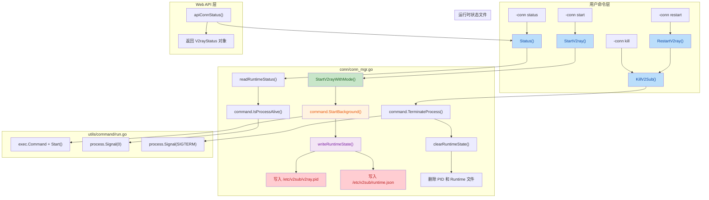

## 1. 高层摘要 (TL;DR)

*   **影响:** **高** - 重构了 v2sub 的核心进程管理机制，从基于内存标志位和 grep 查找进程的方式，改为基于 PID 文件和运行时状态文件的可靠管理模式
*   **关键变更:**
    *   ✅ 新增 **PID 文件管理** (`/etc/v2sub/v2ray.pid`) 和 **运行时状态文件** (`/etc/v2sub/runtime.json`)
    *   ✅ 将 v2ray 启动方式从同步阻塞改为**后台进程启动** (`StartBackground`)
    *   ✅ 新增 `status` 和 `restart` 命令，提供更完整的进程生命周期管理
    *   ✅ 重构进程查找逻辑，从 `ps | grep` 改为基于 PID 的精确控制
    *   ✅ Web API 返回详细的状态对象而非简单的布尔值

---

## 2. 可视化概览 (代码与逻辑映射)



---

## 3. 详细变更分析

### 🔄 核心组件：进程管理重构 (`conn/conn_mgr.go`)

#### **变更说明:**
将 v2ray 进程管理从不可靠的内存标志位 + grep 查找方式，重构为基于文件状态的可靠管理模式。

#### **新增数据结构:**

| 字段 | 类型 | 说明 |
|------|------|------|
| `Running` | bool | 进程是否正在运行 |
| `Pid` | int | 进程 ID |
| `StartedAtUnix` | int64 | 启动时间戳 |
| `BinaryPath` | string | v2ray 二进制路径 |
| `ConfigPath` | string | 配置文件路径 |
| `Mode` | string | 运行模式 (default/pac) |
| `Message` | string | 状态描述信息 |

#### **核心方法变更:**

| 旧方法 | 新方法 | 变更说明 |
|--------|--------|----------|
| `startV2ray()` | `StartV2ray()` / `StartV2rayWithMode(mode)` | 改为后台启动，返回状态对象 |
| `KillV2Sub()` | `KillV2Sub()` | 改为基于 PID 的精确终止 |
| - | `Status()` | 新增，读取并验证实际运行状态 |
| - | `RestartV2ray()` | 新增，先停止再启动 |
| - | `writeRuntimeState()` | 新增，写入状态文件 |
| - | `readRuntimeStatus()` | 新增，读取状态文件 |

#### **关键代码逻辑:**

**启动流程 (Source: `conn/conn_mgr.go:100-179`)**:
```go
// 1. 检查 v2ray 二进制是否存在
if err := checkV2ray(); err != nil {
    return StatusWithMessage(false, 0, mode, err.Error()), err
}

// 2. 检查服务器配置
if len(conf.ServerConfigNow.ServerList) == 0 {
    return StatusWithMessage(false, 0, mode, "server list is empty"), errors.New("...")
}

// 3. 检查是否已运行
currentStatus := Status()
if currentStatus.Running {
    return currentStatus, errors.New("v2ray is already running")
}

// 4. 后台启动进程
cmd, err := command.StartBackground(v2rayBinPath, args...)

// 5. 写入运行时状态
status := V2rayStatus{Running: true, Pid: cmd.Process.Pid, ...}
writeRuntimeState(status)
```

**状态检查流程 (Source: `conn/conn_mgr.go:181-213`)**:
```go
func Status() V2rayStatus {
    // 1. 读取状态文件
    status, err := readRuntimeStatus()
    
    // 2. 验证进程是否存活
    if status.Pid <= 0 || !command.IsProcessAlive(status.Pid) {
        clearRuntimeState()
        return StatusWithMessage(false, 0, status.Mode, "v2ray is not running")
    }
    
    // 3. 返回运行状态
    status.Running = true
    status.Message = "v2ray is running"
    return status
}
```

---

### ⚙️ 工具模块：进程控制增强 (`utils/command/run.go`)

#### **新增功能:**

| 函数 | 功能 | 实现方式 |
|------|------|----------|
| `StartBackground()` | 后台启动进程 | 重定向 I/O 到 `/dev/null`，非阻塞启动 |
| `IsProcessAlive()` | 检查进程存活 | 发送 `Signal(0)` 测试 |
| `TerminateProcess()` | 优雅终止进程 | 发送 `SIGTERM` 信号 |
| `KillProcess()` | 强制杀死进程 | 发送 `SIGKILL` 信号 |

#### **关键代码 (Source: `utils/command/run.go:78-96`)**:
```go
func StartBackground(name string, arg ...string) (*exec.Cmd, error) {
    cmd := exec.Command(name, arg...)
    
    // 重定向所有 I/O 到 /dev/null
    devNull, _ := os.OpenFile(os.DevNull, os.O_RDWR, 0)
    cmd.Stdout = devNull
    cmd.Stderr = devNull
    cmd.Stdin = devNull
    
    cmd.Start()  // 非阻塞启动
    return cmd, nil
}
```

---

### 🌐 Web API：状态查询改进 (`web/api.go`)

#### **API 响应变更:**

| API 端点 | 旧响应 | 新响应 |
|----------|--------|--------|
| `GET /api/conn/status` | `{"running": "true", "lastStartTimeUnix": 123}` | 完整的 `V2rayStatus` 对象 |
| `POST /api/conn/start` | 简单成功/失败 | 包含状态对象的详细响应 |

#### **代码变更 (Source: `web/api.go:77-84`)**:
```go
// 旧代码
func apiConnStatus(ctx *gin.Context) {
    ctx.JSON(200, gin.H{
        "code": RestApiSuccess,
        "data": map[string]interface{}{
            "running": fmt.Sprint(runFlag),
            "lastStartTimeUnix": lastStartTimeUnix,
        },
    })
}

// 新代码
func apiConnStatus(ctx *gin.Context) {
    status := conn.Status()
    ctx.JSON(200, gin.H{
        "code": RestApiSuccess,
        "msg": status.Message,
        "data": status,  // 完整的状态对象
    })
}
```

---

### 📝 配置文件与构建脚本

#### **新增文件:**

| 文件 | 用途 |
|------|------|
| `buildAndInstall.sh` | 自动化构建和安装脚本 |
| `etc_config/config.json` | v2ray 配置模板 |
| `etc_config/config_module.json` | 带占位符的配置模块 |
| `etc_config/server.json` | 服务器列表示例 |
| `etc_config/sub.json` | 订阅源配置示例 |

#### **构建脚本内容 (Source: `buildAndInstall.sh`)**:
```bash
echo "build v2sub..."
go build ./v2sub.go

echo "build v2subw..."
go build ./v2subw.go

echo "install v2sub and v2subw to /usr/bin"
sudo cp ./v2sub /usr/bin/
sudo cp ./v2subw /usr/bin/
sudo chmod +x /usr/bin/v2sub
sudo chmod +x /usr/bin/v2subw
```

---

### 🔧 其他优化

#### **登录验证逻辑重构 (Source: `web/service.go:13-27`)**:
将 `checkLogin()` 函数从 `web/api.go` 移动到 `web/service.go`，并优化了类型断言逻辑，避免潜在的 panic。

#### **命令行帮助更新 (Source: `v2sub.go:84-95`)**:
更新了 `-conn` 命令的帮助文本，新增 `status` 和 `restart` 命令说明。

#### **代码清理:**
- 移除了大量注释掉的代码
- 统一了错误处理模式
- 优化了导入包顺序

---

## 4. 影响与风险评估

### ⚠️ 破坏性变更

| 变更类型 | 影响 | 缓解措施 |
|----------|------|----------|
| **运行时状态文件** | 首次运行需要创建 `/etc/v2sub` 目录 | `ensureRuntimeDir()` 会自动创建 |
| **API 响应格式** | Web 前端需要适配新的 `V2rayStatus` 对象 | 前端需要更新字段映射 |
| **进程查找方式** | 旧版本运行中的 v2ray 进程无法被新版本管理 | 建议升级前手动停止旧进程 |

### 🧪 测试建议

1. **进程启动测试:**
   - 验证 `v2sub -conn start` 能否正确创建 PID 文件
   - 验证后台进程是否正常运行
   - 检查 `runtime.json` 内容是否完整

2. **状态查询测试:**
   - 验证 `v2sub -conn status` 在运行/停止状态下的输出
   - 测试进程异常退出后状态查询的正确性

3. **进程终止测试:**
   - 验证 `v2sub -conn kill` 能否优雅终止进程
   - 测试进程无响应时的强制杀死逻辑

4. **重启测试:**
   - 验证 `v2sub -conn restart` 能否正确保存并恢复运行模式

5. **Web API 测试:**
   - 验证 `/api/conn/status` 返回的完整状态对象
   - 测试并发启动请求的幂等性

6. **边界情况:**
   - 测试服务器列表为空时的启动行为
   - 测试无效 PID 文件的处理
   - 测试权限不足时的错误提示

---

## 5. 总结

这次重构显著提升了 v2sub 的进程管理可靠性：

✅ **优点:**
- 从不可靠的 grep 查找改为精确的 PID 管理
- 提供完整的进程生命周期控制（start/stop/restart/status）
- 状态持久化，支持进程重启后恢复
- 更好的错误处理和状态反馈

📝 **建议:**
- 在生产环境部署前，建议先在测试环境验证所有功能
- 前端需要适配新的 API 响应格式
- 考虑添加日志记录以便排查问题